<div dir="rtl">

<p align="center">
  
</p>

# ری‌بوک · ReBook

**کتاب بعدی‌ات را پیدا کن، کتاب‌هایی را که خواندی بفروش.**

ری‌بوک بازارچهٔ فارسی خرید و فروش کتاب‌های دست دوم است. هر آگهی یک نسخهٔ مشخص از کتاب را با عکس جلد، وضعیت ظاهری و قیمت معرفی می‌کند؛ خریدار نسخه‌ها را مقایسه می‌کند و فروشنده کتابش را به خوانندهٔ بعدی می‌رساند.

این پروژه برای درس توسعهٔ وب کالج فردوسی ساخته شده است؛ رابط کاربری فارسی و راست‌به‌چپ دارد و از مرور کتاب تا ثبت آگهی، سبد خرید و مدیریت معاملات را پوشش می‌دهد.

<p align="center" dir="ltr"><strong>React 19 · Vite 8 · Bootstrap 5 RTL · Django 6 · DRF · SQLite</strong></p>

<p align="center">
  <a href="#preview">پیش‌نمایش</a> · <a href="#features">امکانات</a> · <a href="#setup">راه‌اندازی</a> · <a href="#architecture">معماری</a> · <a href="#checks">بررسی کد</a>
</p>

> **پرداخت آزمایشی است.** هیچ پولی جابه‌جا نمی‌شود و درگاه بانکی واقعی به پروژه متصل نیست.

<a name="preview"></a>

## پیش‌نمایش

صفحهٔ اصلی با جلدهای کتاب و مسیرهای خرید و فروش:


**پیدا کردن نسخهٔ مناسب** — جست‌وجوی عنوان و نویسنده، فیلتر دسته‌بندی، وضعیت و قیمت، و مرتب‌سازی نتایج:


**دیدن جزئیات کتاب** — جلد، وضعیت ظاهری، یادداشت فروشنده و شناسنامهٔ کتاب در یک صفحه:

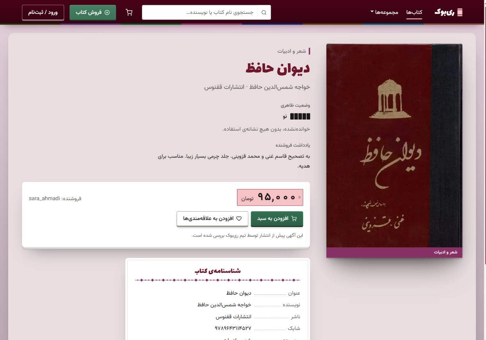

**سبد خرید مهمان** — جمع مبلغ نسخه‌های قابل خرید، پیش از ورود به حساب:

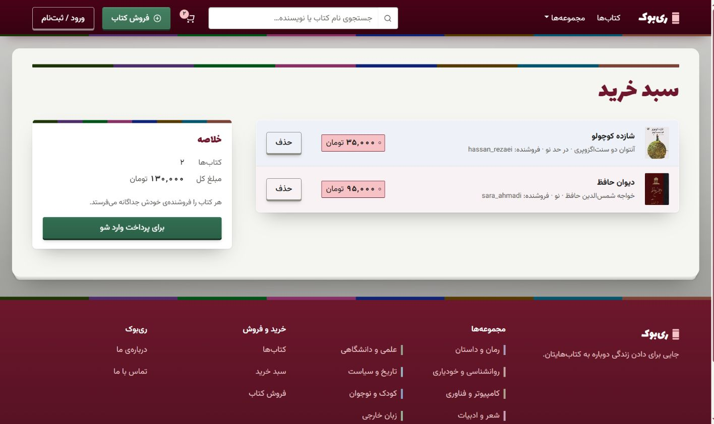

**فروش کتاب و پیش‌نمایش زندهٔ آگهی** — مشخصات نسخه، دسته‌بندی، وضعیت ظاهری و قیمت:


<details>
<summary><strong>ورود و ثبت‌نام</strong></summary>

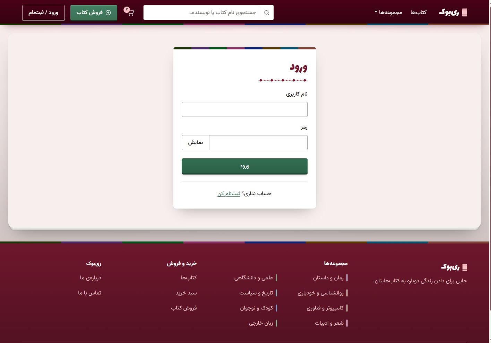

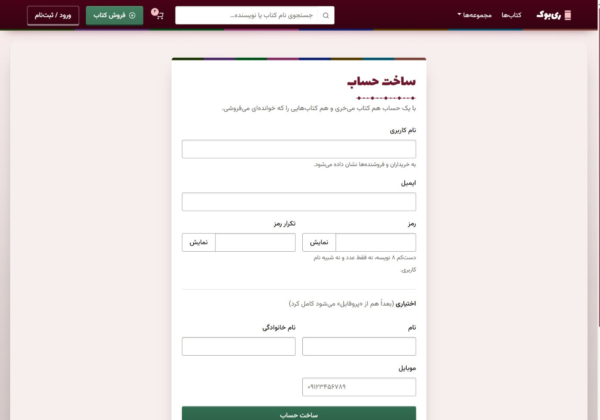

</details>

<details>
<summary><strong>کتاب‌های من، معاملات و علاقه‌مندی‌ها</strong></summary>

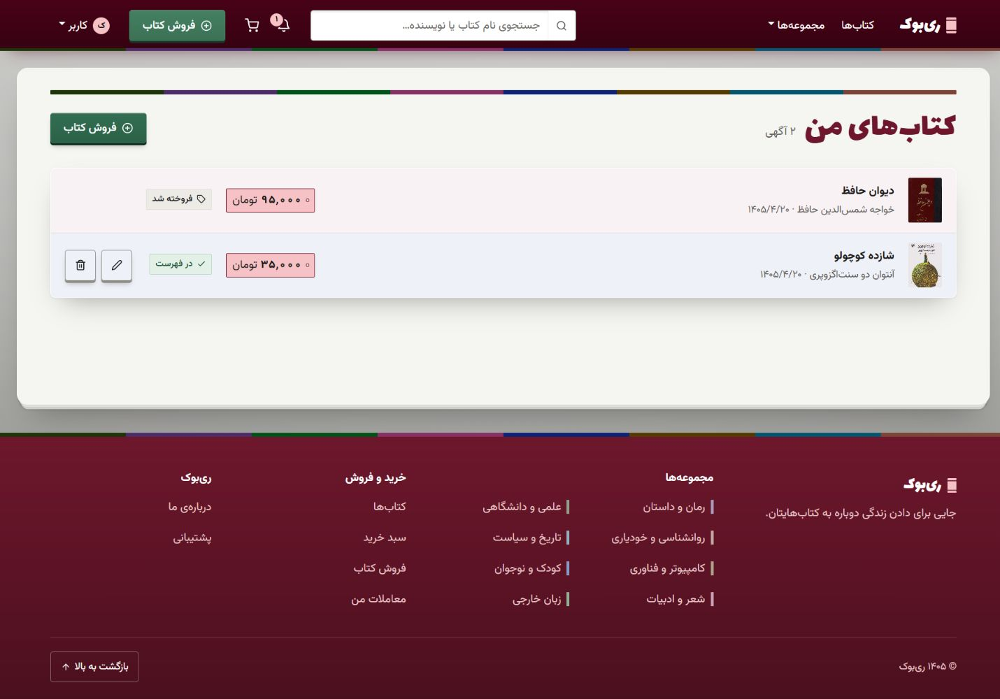

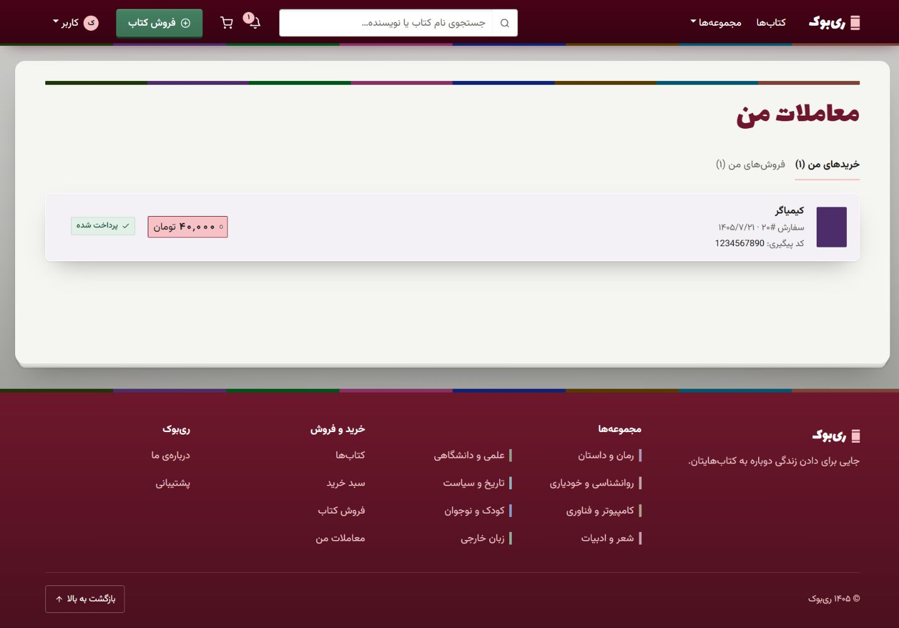

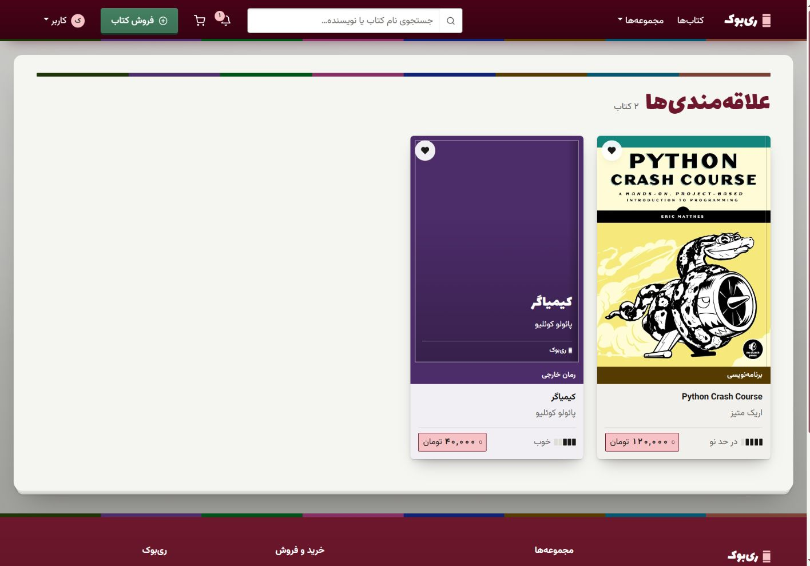

</details>

<details>
<summary><strong>پروفایل، اعلان‌ها و پشتیبانی</strong></summary>

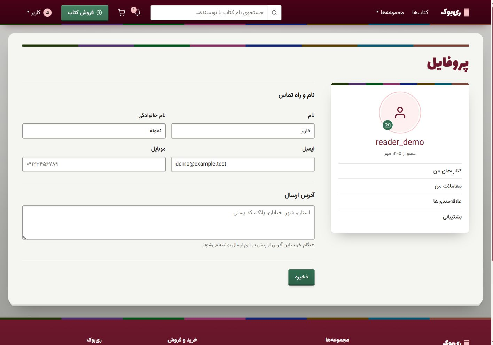

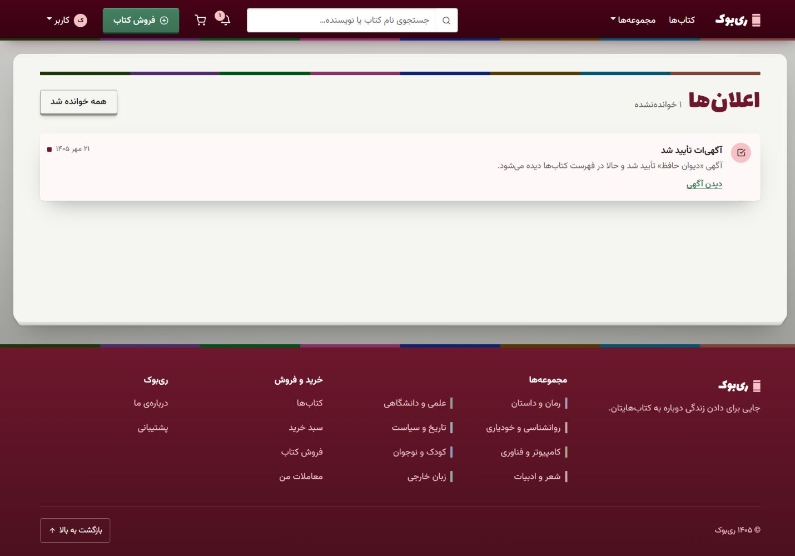

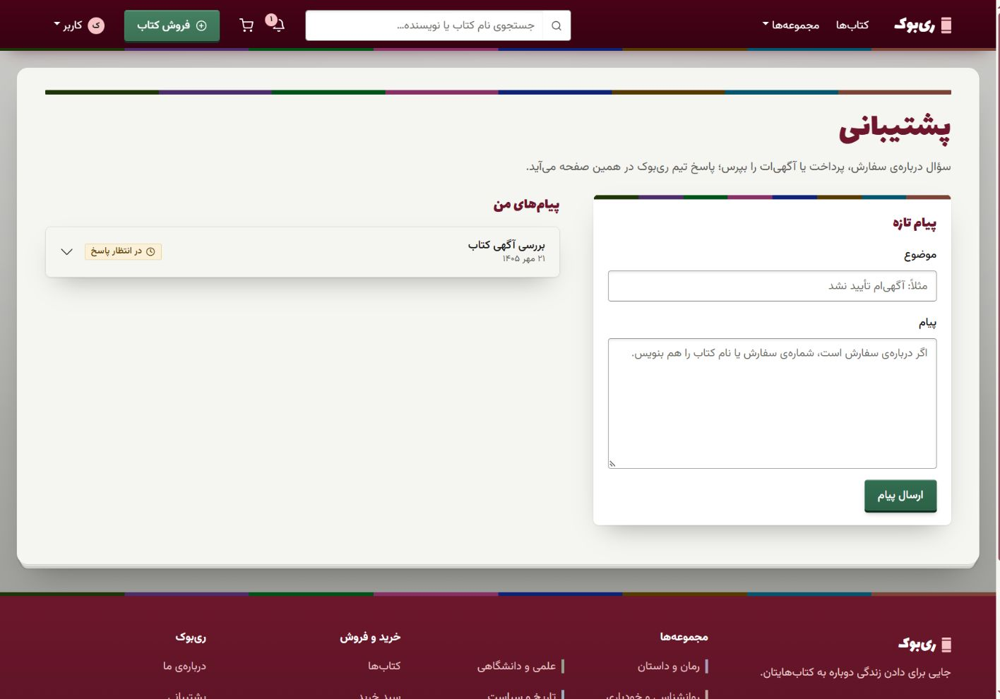

</details>

<details>
<summary><strong>نمای موبایل: مرور، جزئیات، سبد و فروش</strong></summary>

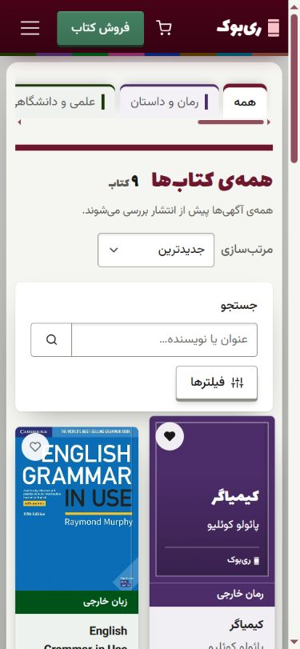


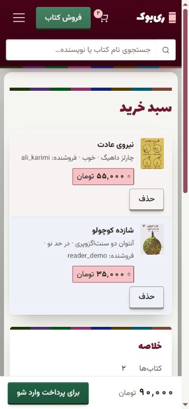

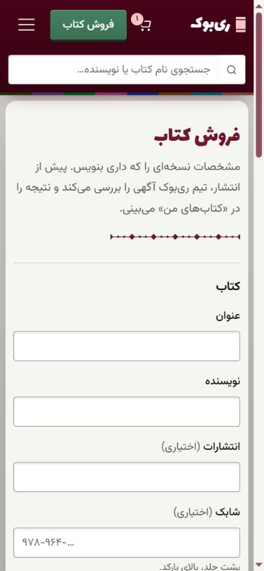

قاب‌های کامل و ادامهٔ فرم‌های بلند، همراه ورود، ثبت‌نام و سایر صفحات، در [گالری کامل](docs/readme/gallery.md) قرار دارند.

</details>

[مشاهدهٔ گالری کامل دسکتاپ و موبایل، شامل درباره و تماس](docs/readme/gallery.md)

تصاویر از اجرای محلی پروژه گرفته شده‌اند. کتاب‌ها و قیمت‌های داخل تصاویر محتوای نمونه‌اند و همراه نصب تازه به‌صورت خودکار ایجاد نمی‌شوند. روش تهیه و به‌روزرسانی آن‌ها در [راهنمای تصاویر](docs/readme/ASSETS.md) آمده است.

<a name="features"></a>

## امکانات

| بخش | قابلیت‌ها |
| --- | --- |
| پیدا کردن کتاب | جست‌وجوی عنوان و نویسنده، دسته‌بندی و زیردسته، فیلتر قیمت و وضعیت ظاهری، مرتب‌سازی و نمایش بیشتر |
| خرید | علاقه‌مندی‌ها، سبد مهمان و کاربر، ادغام سبد پس از ورود یا ثبت‌نام، پرداخت آزمایشی چند کتاب و کد پیگیری مشترک |
| فروش | ثبت و ویرایش آگهی، آپلود جلد، پنج درجهٔ وضعیت ظاهری و مشاهدهٔ آگهی‌های خود کاربر |
| بررسی آگهی | تأیید یا رد در Django Admin، اعلان نتیجه به فروشنده و بررسی دوباره پس از ویرایش |
| حساب کاربری | ثبت‌نام و ورود، پروفایل و تصویر کاربر، فهرست خریدها و فروش‌ها و لغو سفارش در انتظار پرداخت |
| ارتباط | اعلان‌ها، تیکت پشتیبانی برای کاربران و فرم تماس برای مهمان‌ها |

## مسیر خرید و فروش

**خریدار:** مرور کتاب‌ها ← جزئیات نسخه ← افزودن به سبد ← ورود یا ثبت‌نام ← ثبت آدرس و پرداخت آزمایشی ← کد پیگیری و مشاهدهٔ معاملات.

**فروشنده:** ساخت حساب ← ثبت آگهی ← بررسی مدیر ← انتشار در فهرست عمومی ← دریافت اعلان خرید و پرداخت.

- آگهی تازه با وضعیت `pending` ثبت می‌شود؛ تنها آگهی‌های `approved` در فهرست عمومی دیده می‌شوند.
- ویرایش آگهی آن را به صف بررسی برمی‌گرداند. کتاب فروخته‌شده قابل ویرایش یا حذف نیست.
- افزودن به سبد، کتاب را رزرو نمی‌کند؛ موجودبودن و قیمت هر نسخه هنگام پرداخت دوباره بررسی می‌شود.
- پرداخت سبد برای هر کتاب یک سفارش و تراکنش می‌سازد؛ همهٔ آن‌ها یک کد پیگیری مشترک دارند و تغییرات خرید در یک تراکنش پایگاه داده ثبت می‌شوند.
- مسیر سفارش تکی نیز برای سفارش‌های در انتظار پرداخت موجود است؛ خریدار یا فروشنده می‌تواند سفارش باز را لغو کند.

## طراحی

هویت بصری ری‌بوک از کتاب‌های جیبی و شناسنامه‌های چاپی الهام می‌گیرد: کاغذ روشن، رنگ شرابی برای برند، سبز برای کنش‌ها و هشت رنگ مجموعه روی جلدها و عطف‌ها. لاله‌زار برای عنوان‌های نمایشی و وزیرمتن برای متن و کنترل‌ها استفاده می‌شود. جهت راست‌به‌چپ، ارقام فارسی، قیمت به تومان و تاریخ شمسی جزئی از تجربهٔ محصول هستند.

<a name="setup"></a>

## راه‌اندازی محلی

### پیش‌نیازها

- Git
- Python **3.12 یا بالاتر**
- Node.js **22.13 یا بالاتر از شاخهٔ 22، یا 24 به بالا** به همراه npm؛ محدودهٔ نسخهٔ پشتیبانی‌شده توسط ابزارهای فعلی پروژه `^20.19.0 || ^22.13.0 || >=24` است.

ابتدا مخزن را clone کنید و وارد پوشهٔ ریشهٔ پروژه شوید:

<div dir="ltr">

```bash
git clone https://github.com/SinaNazeran/ReBook.git
cd ReBook
```

</div>

بک‌اند و فرانت‌اند در **دو ترمینال جدا** اجرا می‌شوند.

### ۱. بک‌اند

<details open>
<summary><strong>Windows · PowerShell</strong></summary>

<div dir="ltr">

```powershell
python -m venv venv
cd backend
..\venv\Scripts\python.exe -m pip install -r requirements.txt
Copy-Item .env.example .env
```

</div>

</details>

<details>
<summary><strong>Linux / macOS · Bash</strong></summary>

<div dir="ltr">

```bash
python3 -m venv venv
cd backend
../venv/bin/python -m pip install -r requirements.txt
cp .env.example .env
```

</div>

</details>

فایل `backend/.env` را باز کنید و مقدار `DJANGO_SECRET_KEY` را با یک کلید تصادفی جایگزین کنید. مقدار `DJANGO_DEBUG=1` برای اجرای محلی و نمایش تصاویر باقی بماند.

برای تولید کلید، در همان پوشهٔ `backend` یکی از این دستورها را اجرا کنید:

<div dir="ltr">

```powershell
# Windows
..\venv\Scripts\python.exe -c "from django.core.management.utils import get_random_secret_key; print(get_random_secret_key())"
```

```bash
# Linux / macOS
../venv/bin/python -c "from django.core.management.utils import get_random_secret_key; print(get_random_secret_key())"
```

</div>

سپس دیتابیس و حساب مدیر را بسازید و سرور را اجرا کنید:

<div dir="ltr">

```powershell
# Windows — from backend/
..\venv\Scripts\python.exe manage.py migrate
..\venv\Scripts\python.exe manage.py createsuperuser
..\venv\Scripts\python.exe manage.py runserver
```

```bash
# Linux / macOS — from backend/
../venv/bin/python manage.py migrate
../venv/bin/python manage.py createsuperuser
../venv/bin/python manage.py runserver
```

</div>

### ۲. فرانت‌اند

در ترمینال دوم، از ریشهٔ پروژه:

<div dir="ltr">

```bash
cd frontend
npm ci
npm run dev -- --port 5173 --strictPort
```

</div>

| مقصد | آدرس |
| --- | --- |
| وب‌سایت | <http://localhost:5173> |
| API | <http://localhost:8000/api/> |
| پنل مدیریت | <http://localhost:8000/admin/> |

### ۳. اولین کتاب قابل نمایش

نصب تازه دیتابیس خالی دارد و دستور seed آماده در مخزن نیست:

1. با حساب مدیر وارد پنل مدیریت شوید و چند دسته‌بندی بسازید؛ برای زیردسته، دستهٔ والد را مشخص کنید.
2. در سایت یک حساب فروشنده بسازید و از «فروش کتاب» آگهی ثبت کنید.
3. در پنل مدیریت، وضعیت آگهی را به «تأیید شده» تغییر دهید و ذخیره کنید.
4. کتاب اکنون در فهرست عمومی نمایش داده می‌شود. برای امتحان خرید، حساب دیگری بسازید؛ خرید آگهی خود کاربر مجاز نیست.

دیتابیس `backend/db.sqlite3`، فایل‌های آپلودی `backend/media/` و فایل‌های `.env` محلی‌اند و در Git ثبت نمی‌شوند.

### تنظیمات محیطی

| فایل | متغیر | کاربرد |
| --- | --- | --- |
| `backend/.env` | `DJANGO_SECRET_KEY` | ضروری؛ کلید محرمانهٔ تصادفی |
| `backend/.env` | `DJANGO_DEBUG` | برای اجرای محلی `1`؛ بدون آن تصاویر با سرور توسعه سرو نمی‌شوند |
| `backend/.env` | `DJANGO_ALLOWED_HOSTS` | اختیاری؛ میزبان‌ها با ویرگول جدا می‌شوند؛ پیش‌فرض `localhost,127.0.0.1` |
| `backend/.env` | `DJANGO_SECURE_COOKIES` | برای HTTPS مقدار `1`؛ در اجرای HTTP محلی فعال نشود |
| `frontend/.env` | `VITE_API_URL` | در توسعه اختیاری؛ برای ساخت نسخهٔ انتشار، نشانی HTTPS لازم است |
| `frontend/.env` | `VITE_SITE_URL` | برای ساخت نسخهٔ انتشار ضروری؛ مبدأ HTTPS فرانت‌اند، بدون مسیر، برای نشانی‌های canonical |

برای تغییر نشانی API، فایل `frontend/.env` را با مقدار زیر بسازید و Vite را دوباره اجرا کنید:

<div dir="ltr">

```dotenv
VITE_API_URL=http://localhost:8000/api
```

</div>

برای ساخت نسخهٔ انتشار، هر دو متغیر را با نشانی واقعی سرویس‌ها تنظیم کنید. نمونه‌های `frontend/.env.example` فقط برای بررسی محلی‌اند و دامنهٔ انتشار نیستند. جزئیات و محدودیت‌های canonical در [راهنمای canonical](docs/reliability/canonical-urls.md) آمده است.

فرانت‌اند و بک‌اند را با نام میزبان یکسان باز کنید: هر دو `localhost` یا هر دو `127.0.0.1`. برای تغییر پورت یا مبدأ فرانت‌اند، هر دو فهرست `CORS_ALLOWED_ORIGINS` و `CSRF_TRUSTED_ORIGINS` در [تنظیمات بک‌اند](backend/config/settings.py) باید به‌روز شوند.

<a name="architecture"></a>

## معماری

فرانت‌اند یک SPA با React Router است؛ صفحه‌ها به‌صورت lazy بارگذاری می‌شوند و فراخوانی‌های API در یک لایهٔ مشترک Axios قرار دارند. وضعیت حساب و سبد در Context نگهداری می‌شود. بک‌اند از viewهای generic در DRF، مدل کاربر سفارشی و SQLite استفاده می‌کند.

<div dir="ltr">

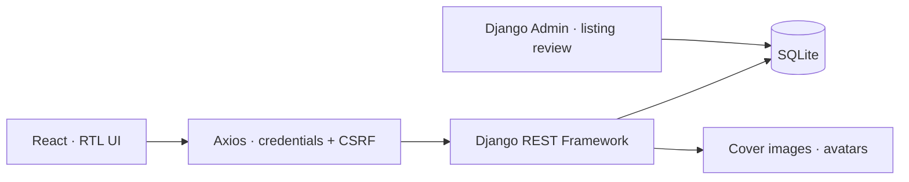

</div>

احراز هویت بر پایهٔ **Session و CSRF** است. سبد مهمان در Session و سبد حساب در مدل `CartItem` ذخیره می‌شود. دسترسی به منابع شخصی با محدودکردن queryset به کاربر اعمال می‌شود؛ اطلاعات عمومی فروشنده شامل شناسه و نام کاربری است.

<div dir="ltr">

```text
backend/
  accounts/        User, session authentication, profile
  books/           Book, Category, Wishlist, admin review
  orders/          Order, Transaction, CartItem, checkout
  notifications/   Notifications, support tickets, contact messages
  config/          Settings, URLs, pagination, image processing
frontend/src/
  pages/           Public and account pages
  components/      Shared UI, book covers, receipt, forms
  context/         Authentication and cart state
  services/api.js  API calls and error handling
  styles/          Theme tokens and depth
  utils/           Persian digits, categories, motion helpers
docs/readme/       Introduction images and banner source
```

</div>

فناوری‌های مکمل: React Bootstrap، React Icons، React Toastify، GSAP و Pillow. تصاویر جلد و پروفایل هنگام آپلود کوچک و به WebP تبدیل می‌شوند.

<a name="checks"></a>

## تست و بررسی کد

از پوشهٔ `backend`:

<div dir="ltr">

```powershell
# Windows
..\venv\Scripts\python.exe manage.py test
..\venv\Scripts\python.exe -m ruff check .
```

```bash
# Linux / macOS
../venv/bin/python manage.py test
../venv/bin/python -m ruff check .
```

</div>

از پوشهٔ `frontend`:

<div dir="ltr">

```bash
npm run lint
npm test -- --pool=threads --maxWorkers=1
npm run build
npx playwright install chromium
npm run test:smoke
```

</div>

تست‌های بک‌اند ثبت‌نام، نمایش آگهی، بررسی مدیر، سبد مهمان، ادغام سبد، تغییر قیمت، پرداخت تکراری و تماس مهمان را پوشش می‌دهند. تست‌های Vitest رفتار اجزای فرانت‌اند را بررسی می‌کنند. دستور `test:smoke` با Playwright، مرور کتاب‌ها، ورود و خروج و خرید آزمایشی را در مرورگر دسکتاپ و نمای موبایل، با API واقعی و داده‌های موقت جداگانه اجرا می‌کند؛ سرورها را خودش راه می‌اندازد و به دیتابیس و آپلودهای محلی دست نمی‌زند. نصب Chromium فقط بار اول لازم است. [راهنمای اجرای smoke test و محدودیت‌ها](docs/reliability/smoke-tests.md).

## رفع اشکال رایج

| مشکل | بررسی |
| --- | --- |
| خطای `DJANGO_SECRET_KEY` هنگام اجرا | فایل `backend/.env` و وجود کلید را بررسی کنید. |
| خطای CSRF هنگام ورود یا افزودن به سبد | میزبان یکسان، پورت `5173`، مبدأهای مجاز و غیرفعال‌بودن secure cookies روی HTTP را بررسی کنید. |
| آگهی در فهرست دیده نمی‌شود | مدیر باید آن را تأیید کند؛ ویرایش، وضعیت را دوباره `pending` می‌کند. |
| تصویر جلد نمایش داده نمی‌شود | وجود فایل در `backend/media/` و `DJANGO_DEBUG=1` در اجرای محلی را بررسی کنید. |
| پورت `5173` اشغال است | برنامهٔ استفاده‌کننده از پورت را شناسایی کنید؛ برای پورت جایگزین، تنظیمات CORS و CSRF را هم تغییر دهید. |

## وضعیت پروژه

پروژه یک نمونه‌کار آموزشی با جریان‌های خرید و فروش پیاده‌سازی‌شده است. پرداخت شبیه‌سازی می‌شود؛ مقدارهای «ارسال شده» و «تحویل داده شده» در مدل سفارش وجود دارند، اما اتصال به سرویس حمل‌ونقل پیاده‌سازی نشده است.

دستورهای بالا برای توسعهٔ محلی‌اند. استقرار عمومی به تنظیمات محیط تولید، HTTPS، سرو مستقل فایل‌های static و media و اتصال درگاه واقعی نیاز دارد.

</div>
