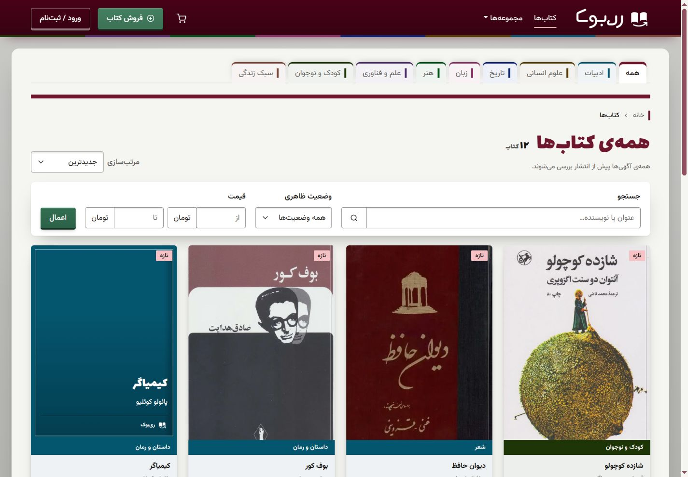
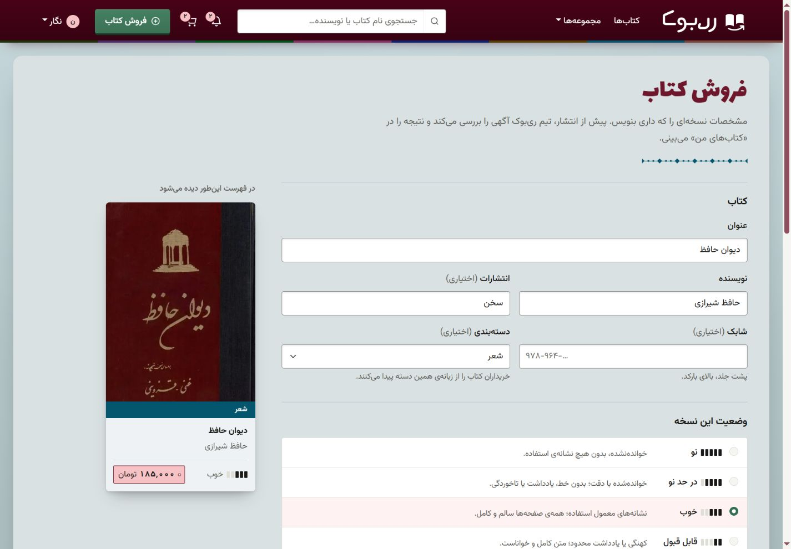

<div dir="rtl">

<p align="center">
  
</p>

# ری‌بوک · ReBook

<p align="center"><strong>بازارچهٔ فارسی کتاب‌های دست‌دوم</strong><br />
کتاب بعدی‌ات را پیدا کن، کتاب‌هایی را که خوانده‌ای بفروش.</p>

<p align="center" dir="ltr">
  
  
  <br />
  
  
  
</p>

<p align="center"><strong><a href="#preview">پیش‌نمایش</a> · <a href="#features">امکانات</a> · <a href="#setup">راه‌اندازی</a></strong></p>

> [!NOTE]
> **پرداخت آزمایشی** — پرداخت‌ها شبیه‌سازی می‌شوند؛ هیچ مبلغی دریافت نمی‌شود.

<a name="preview"></a>

## پیش‌نمایش


<details>
<summary><strong>فهرست کتاب‌ها و ثبت آگهی</strong></summary>

جست‌وجو و فیلتر نسخه‌ها بر اساس دسته، وضعیت و قیمت:



ثبت مشخصات کتاب همراه پیش‌نمایش آگهی:



</details>

<p align="center">
  
  
</p>

تصاویر از اجرای محلی با محتوای نمونه گرفته شده‌اند؛ داده‌های آن‌ها همراه نصب تازه ایجاد نمی‌شوند.

<a name="features"></a>

## امکانات

- جست‌وجو، دسته‌بندی و فیلتر کتاب‌ها؛ جلد، وضعیت ظاهری و یادداشت هر نسخه.
- سبد مهمان و کاربر، علاقه‌مندی‌ها و پرداخت آزمایشی چند کتاب.
- ثبت و ویرایش آگهی، بارگذاری جلد و تأیید آگهی در پنل مدیریت.
- پروفایل، فهرست خرید و فروش، اعلان‌ها و تیکت پشتیبانی.
- رابط فارسی و واکنش‌گرا، قیمت به تومان و تاریخ شمسی.

<a name="setup"></a>

## راه‌اندازی محلی

**پیش‌نیاز:** Python نسخهٔ ۳٫۱۲ یا بالاتر و Node.js نسخهٔ ۲۲٫۱۳ یا بالاتر از شاخهٔ ۲۲، یا نسخهٔ ۲۴ به بالا؛ به همراه npm.

<div dir="ltr">

```bash
git clone https://github.com/SinaNazeran/ReBook.git
cd ReBook
python -m venv venv
```

</div>

محیط مجازی را فعال کنید: در PowerShell دستور <code dir="ltr">.\venv\Scripts\Activate.ps1</code> و در Linux/macOS دستور <code dir="ltr">source venv/bin/activate</code>؛ در صورت نیاز، برای ساخت محیط از `python3` استفاده کنید.

**ترمینال اول — بک‌اند:**

<div dir="ltr">

```bash
cd backend
python -m pip install -r requirements.txt
cp .env.example .env
```

</div>

در `backend/.env`، مقدار `DJANGO_SECRET_KEY` را با خروجی دستور زیر جایگزین کنید و برای اجرای محلی `DJANGO_DEBUG=1` را نگه دارید:

<div dir="ltr">

```bash
python -c "from django.core.management.utils import get_random_secret_key; print(get_random_secret_key())"
python manage.py migrate
python manage.py createsuperuser
python manage.py runserver
```

</div>

**ترمینال دوم — فرانت‌اند، از ریشهٔ پروژه:**

<div dir="ltr">

```bash
cd frontend
npm ci
npm run dev -- --port 5173 --strictPort
```

</div>

[وب‌سایت](http://localhost:5173) · [پنل مدیریت](http://localhost:8000/admin/) · [API](http://localhost:8000/api/books/)

نصب تازه دیتابیس خالی دارد. در پنل مدیریت دسته بسازید، با حساب فروشنده در سایت آگهی ثبت کنید و آن را در پنل مدیریت تأیید کنید. برای امتحان خرید از حساب دیگری استفاده کنید.

<details>
<summary><strong>تست و تنظیمات تکمیلی</strong></summary>

با محیط مجازی فعال، در `backend` دستورهای `python manage.py test` و `python -m ruff check .`؛ در `frontend` دستورهای `npm run lint` و `npm test -- --pool=threads --maxWorkers=1` را اجرا کنید. [راهنمای آزمون مرورگر](docs/reliability/smoke-tests.md).

احراز هویت با Session و CSRF انجام می‌شود؛ برای اجرای محلی، میزبان‌ها را یکسان و فرانت‌اند را روی پورت 5173 نگه دارید. تنظیم `VITE_API_URL` در توسعه اختیاری است. ساخت نسخهٔ انتشار به `VITE_API_URL` و `VITE_SITE_URL` معتبر با HTTPS نیاز دارد.

فایل‌های `.env`، دیتابیس و آپلودها محلی‌اند. استقرار عمومی به تنظیمات محیط تولید و سرو مستقل فایل‌ها نیاز دارد؛ اتصال درگاه بانکی و سرویس حمل‌ونقل پیاده‌سازی نشده است. [تنظیم محدودیت درخواست‌ها](docs/security/rate-limits.md) · [پایش خطاها](docs/reliability/error-monitoring.md).

</details>

</div>
