

# گالری ری‌بوک

[بازگشت به README](../../README.md)

تصاویر واقعی اجرای محلی پروژه با محتوای نمونه. تصاویر حساب و معاملات با کاربر نمایشی و یک نسخهٔ موقت از دیتابیس تهیه شده‌اند؛ اطلاعات شخصی یا خرید واقعی در آن‌ها نیست.

## دسکتاپ

<strong>صفحهٔ اصلی</strong>

<strong>فهرست و جست‌وجو</strong>

<strong>جزئیات کتاب</strong>

<strong>سبد خرید</strong>

<strong>فروش کتاب و پیش‌نمایش زنده</strong>

<strong>ورود</strong>

<strong>ثبت‌نام</strong>

<strong>کتاب‌های من</strong>

<strong>معاملات من</strong>

<strong>علاقه‌مندی‌ها</strong>

<strong>اعلان‌های بررسی آگهی</strong>

<strong>پروفایل نمونه</strong>

<strong>پشتیبانی</strong>

<strong>دربارهٔ ری‌بوک</strong>

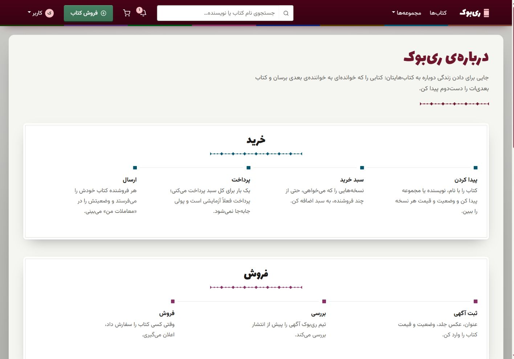

<strong>تماس با ما</strong>

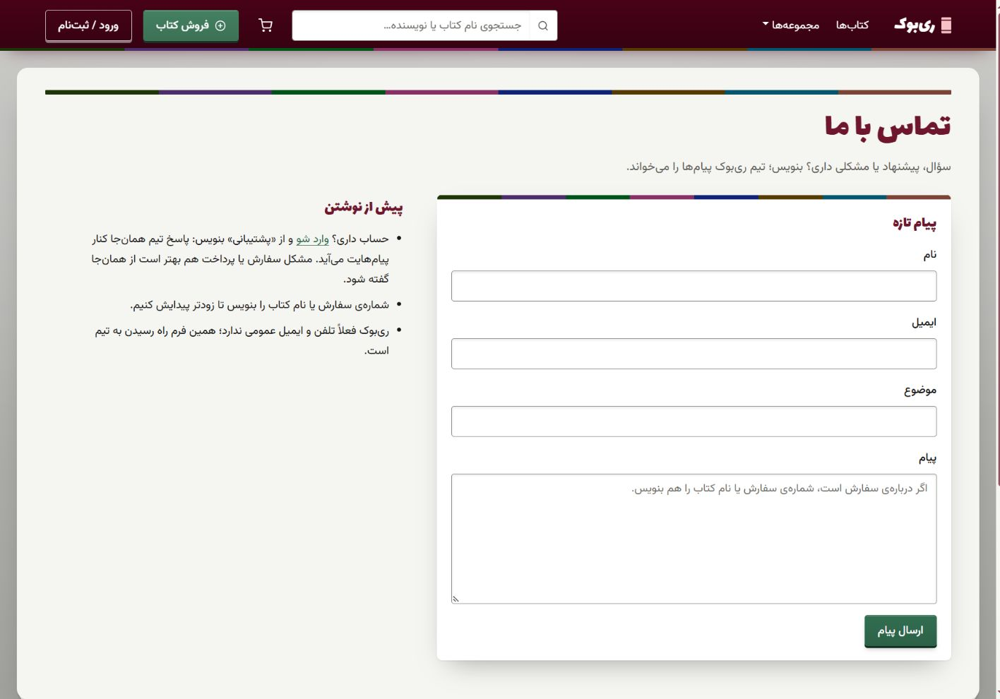

## موبایل

تصاویر در عرض ۳۹۰ پیکسل و ارتفاع ۸۴۴ پیکسل مرورگر ثبت شده‌اند؛ ابعاد خروجی ممکن است با نمایشگر متفاوت باشند. هر تصویر یک قاب طبیعی از صفحه است. فرم‌های بلند در چند قاب با هم‌پوشانی نشان داده می‌شوند؛ چیدمان واقعی موبایل ثبت شده است و ترتیب هر گروه، ادامهٔ مسیر از بالا به پایین است.

### خانه و پیدا کردن کتاب

  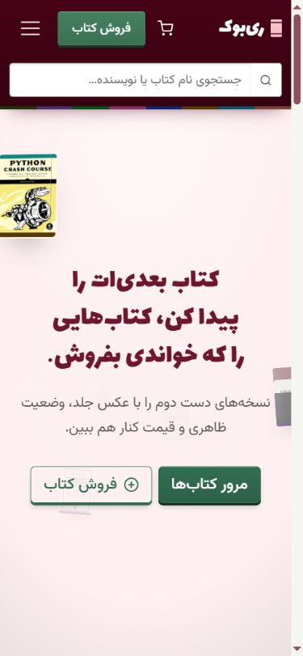
  
  
  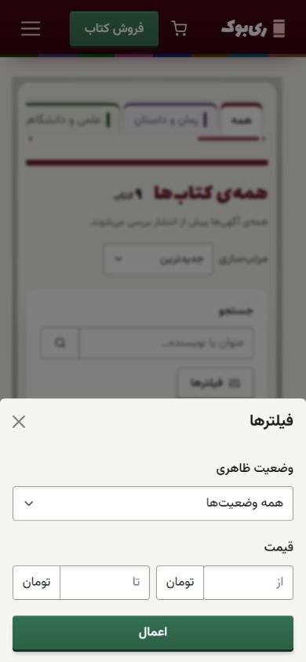

1٫ صفحهٔ اصلی · 2٫ فهرست و جست‌وجو · 3٫ مقایسهٔ وضعیت و قیمت · 4٫ فیلترهای موبایل

### جزئیات نسخه

  
  
  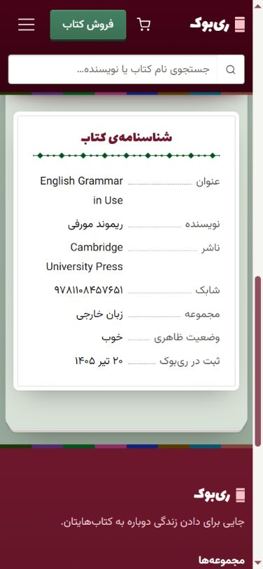

1٫ جلد و عنوان · 2٫ وضعیت، یادداشت و قیمت · 3٫ شناسنامهٔ کتاب

### سبد خرید

  
  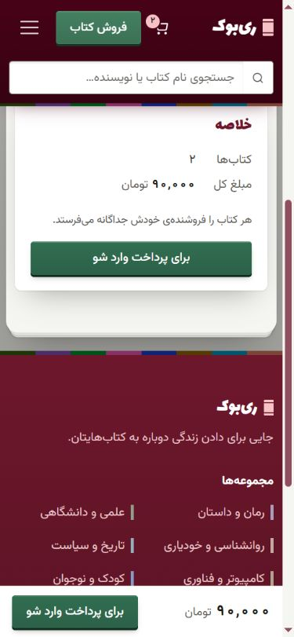

1٫ کتاب‌های سبد · 2٫ مبلغ و ادامهٔ خرید

### ورود و ثبت‌نام

  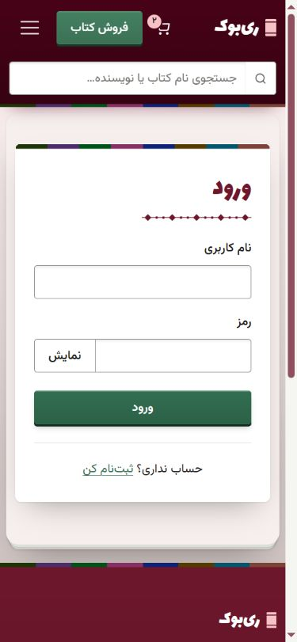
  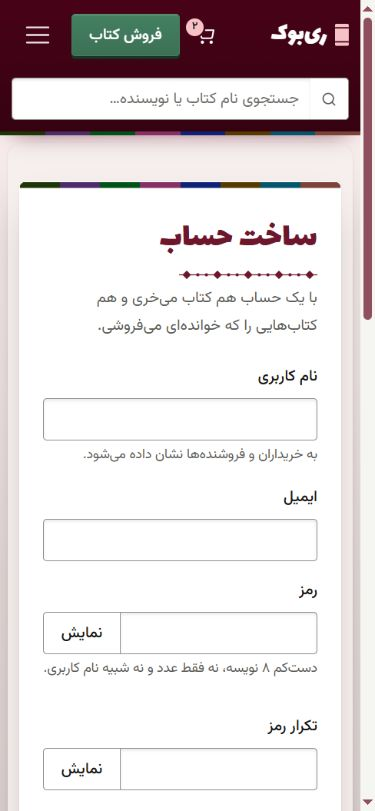
  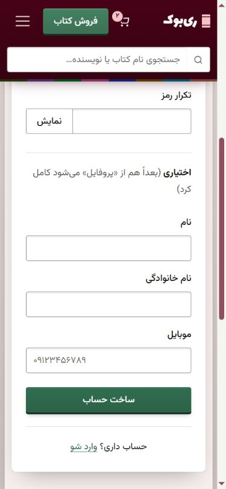

1٫ ورود · 2٫ اطلاعات ورود حساب · 3٫ ادامهٔ فرم و ساخت حساب

### فروش کتاب

  
  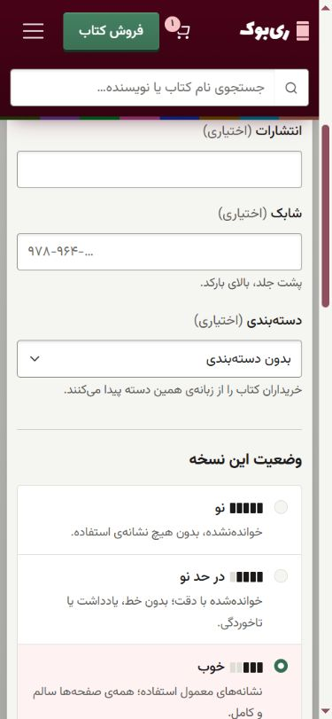
  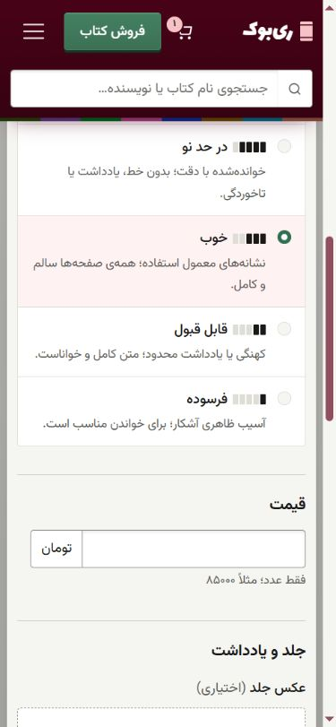
  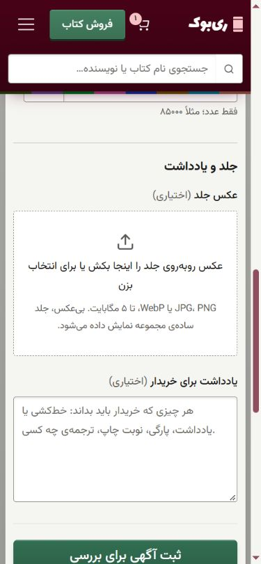
  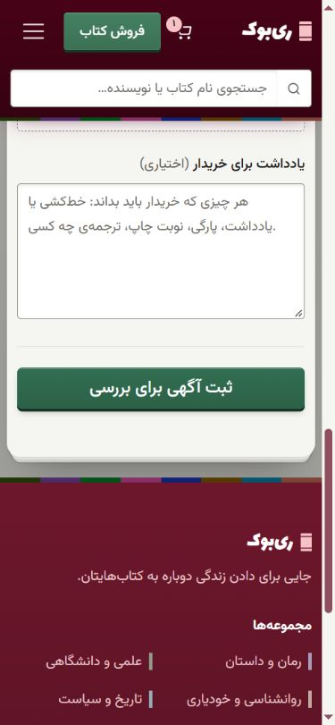

1٫ مشخصات کتاب · 2٫ دسته‌بندی و وضعیت · 3٫ درجه‌ها و قیمت · 4٫ جلد و یادداشت · 5٫ ثبت برای بررسی

### معاملات و اعلان‌ها

  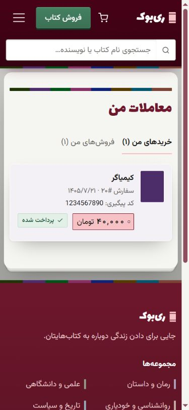
  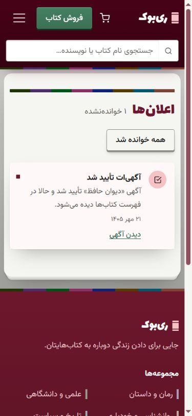

1٫ معاملات و کد پیگیری · 2٫ نتیجهٔ بررسی آگهی

